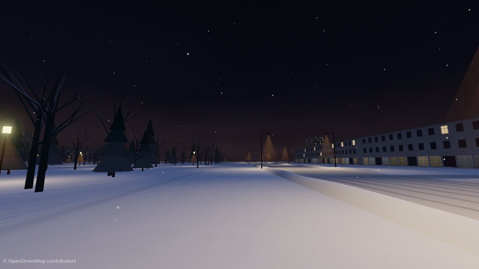
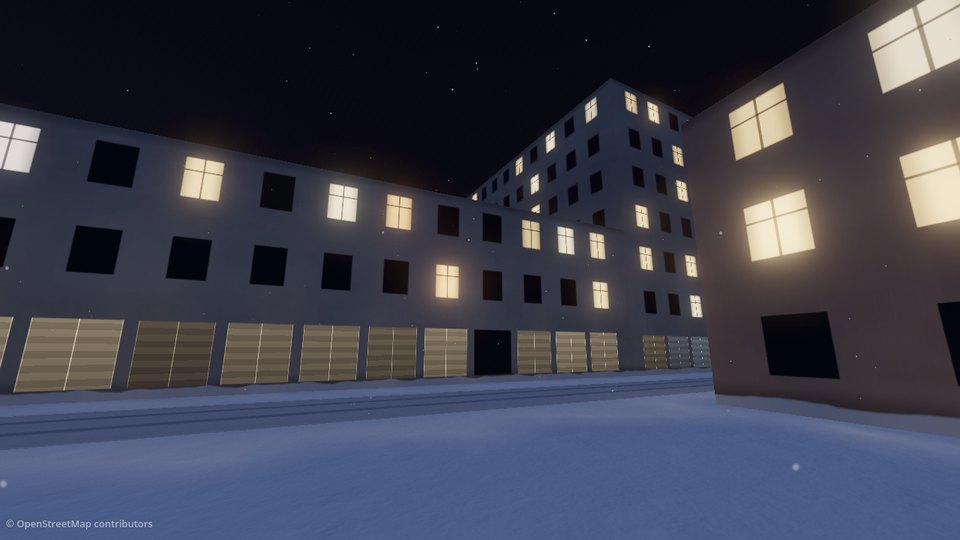
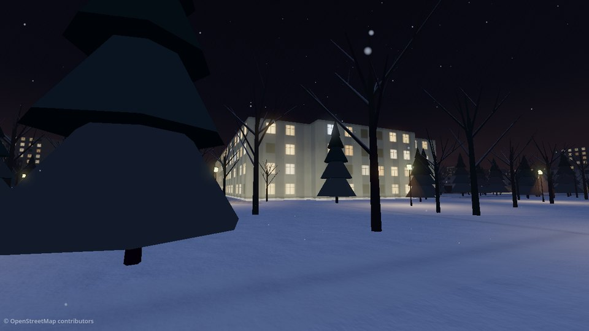
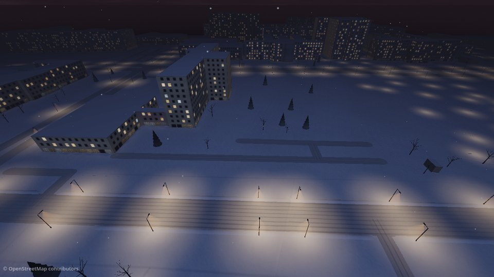
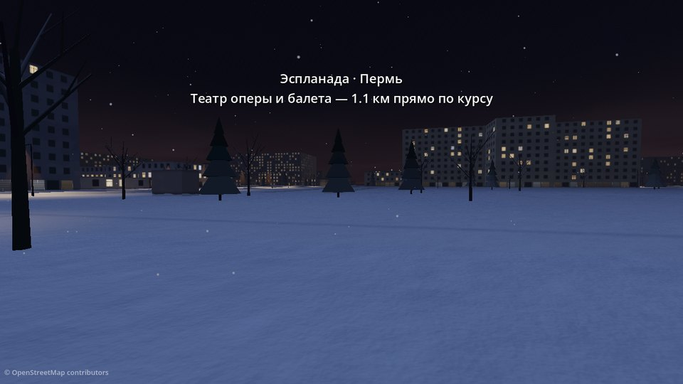
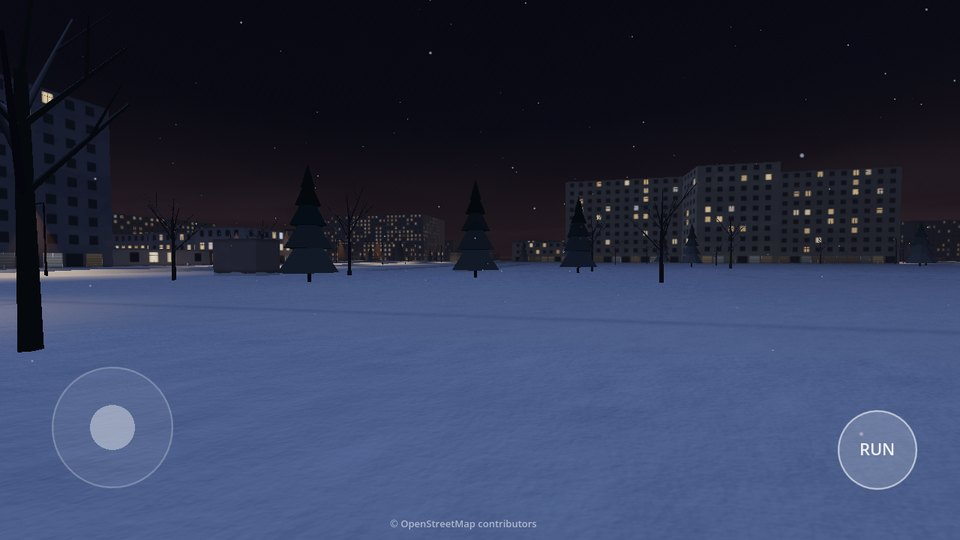

# Perm Winter Walk

A first-person walk through a stylized, snowy, night-time centre of **Perm, Russia**:
from the **Esplanade** to the **Opera and Ballet Theatre**, down to the frozen **Kama**.
The city is generated at runtime from **OpenStreetMap** data. Godot 4.7, GDScript,
Mobile renderer, Android first, with a keyboard/mouse desktop mode.

| | |
|---|---|
|  |  |
|  |  |
|  |  |

*Screenshots are real frames from the game (Mobile renderer, software Vulkan in the build sandbox).*

## Features

* **OSM city, generated at runtime**: 1,083 buildings extruded from footprints
  (`height`, else `building:levels` × 3 m, **default 3 levels**), roads, footpaths, parks,
  squares and the frozen Kama, streamed in 250 m chunks.
* **Night and winter**: cold blue ambient light, weak moonlight, light depth fog,
  a city-glow sky, snow on roofs, snow banks along kerbs, tyre ruts on the roads.
* **Windows** glow warm yellow from a facade shader: each window is on or off, has its
  own warmth and brightness, a few flicker (TVs, tired bulbs). There are shop fronts on
  the ground floor, and landmarks (the Opera) are floodlit. Emissive, with glow/bloom.
* **Street lamps**: OSM `highway=street_lamp` nodes plus generated ones along streets and
  park paths (≈1,900 in the area). Each has an emissive bulb, a warm light cone and a
  pool of light on the snow. Only 6 real lights are used, following the lamps nearest
  to you; the rest is faked (see Performance).
* **Snow**: GPU particle snowfall that follows the camera, sparkle on the snow,
  boot prints that stay behind you.
* **Sound**: crunching-snow footsteps synced to your stride (pitch/volume vary, never
  the same sample twice in a row) and a soft wind loop. All sounds are generated and CC0.
* **Controls**: left virtual joystick to move, drag on the right to look, RUN toggle.
  Desktop: WASD/arrows + mouse, Shift to run. Gamepads work too.
* **Spawn** on the Esplanade facing the Opera Theatre (1.1 km away, behind the city
  blocks, as in reality). A caption says so for a few seconds.

## Repository layout

```
perm-winter-walk/
  game/                      Godot project (open game/project.godot)
    scenes/main.tscn         entry scene (everything else is built in code)
    scripts/main.gd          wiring: atmosphere, city, player, UI, FX
    scripts/player.gd        first-person controller, stride-based footfalls
    scripts/touch_controls.gd   multi-touch joystick / look / run
    scripts/atmosphere.gd    sky, ambient, moon, fog, glow
    scripts/city/            chunk_streamer.gd, chunk_loader.gd, props.gd, lamp_light_pool.gd
    scripts/fx/              snowfall.gd, footsteps.gd, ambience.gd
    scripts/debug_runner.gd  command-line tests and screenshots
    shaders/                 facade, snow_surface, road_decal, light_cone, snowfall, footprint, sky
    data/perm/               generated map chunks + manifest.json (format: data/FORMAT.md)
    audio/, textures/        generated CC0 assets
    export_presets.cfg       Android (arm64) and Linux presets
  tools/
    preprocess_osm.py        OSM -> chunk files (Overpass / .osm.pbf / GeoJSON)
    fetch_overture_osm.py    dev fallback used in the sandbox (OSM-only records, see below)
    test_preprocess.py       tests for all input paths and the output format
    inspect_chunks.py        decodes chunks and draws a map (docs/map.jpg)
    make_sounds.py, make_textures.py   regenerate the CC0 audio / textures
  docs/                      screenshots and the map overview
  CREDITS.md                 licences: ODbL map data, CC0 sounds and textures
```

## Run on desktop (keyboard and mouse)

1. Install **Godot 4.7.2** (standard build, not .NET): <https://godotengine.org/download>
2. Open `game/project.godot` in the editor and press **F5**, or from a terminal:

   ```sh
   godot --path game
   ```

| action | desktop | phone |
|---|---|---|
| move | W A S D / arrow keys, gamepad left stick | left-side joystick (appears under your thumb) |
| look | mouse (click to capture, Esc to release), gamepad right stick | drag on the right side |
| run | hold Shift (or L3) | tap **RUN** (toggle) |
| debug overlay (fps, draw calls, chunks) | F3 | – |
| touch UI on desktop (for testing) | F4, or start with `-- --touch` | – |

Walking speed is 1.4 m/s, running 3 m/s.

## Android

### Use the debug APK

The debug APK (`perm-winter-walk-debug.apk`, arm64-v8a, about 32 MB) was built from this
project in the sandbox and handed over with this delivery. APK files are kept out of git
by this repository's `.gitignore`. Install with:

```sh
adb install -r perm-winter-walk-debug.apk
```

(or copy it to the phone and open it; allow installs from unknown sources). It targets
Android 7.0+ (API 24) and expects a Vulkan-capable GPU, which every Snapdragon 7-series has.

### Build the APK yourself

You need: Godot 4.7.2 + its **export templates**, a **JDK 17 or newer**, and the
**Android SDK** with `platform-tools`, `build-tools;35.0.1` and `platforms;android-35`
(Android Studio's SDK Manager, or `sdkmanager "platform-tools" "build-tools;35.0.1" "platforms;android-35"`).

In the editor:

1. **Editor → Manage Export Templates → Download and Install** (4.7.2).
2. **Editor → Editor Settings → Export → Android**: set *Java SDK Path* and
   *Android SDK Path* and a *debug keystore* (if the field is empty, make one with):
   `keytool -keyalg RSA -genkeypair -alias androiddebugkey -keypass android -keystore debug.keystore -storepass android -dname "CN=Android Debug,O=Android,C=US" -validity 9999 -deststoretype pkcs12`
3. **Project → Export… → Android → Export Project**, untick *Export With Debug* for a
   release build (which needs a release keystore). The preset already exports only
   arm64-v8a and includes the map files (`data/*.bin, data/*.json`).

From a terminal (this is exactly what was run to build the delivered APK):

```sh
cd game
godot --headless --import                       # first time only: import assets
godot --headless --export-debug "Android" ../build/perm-winter-walk-debug.apk
```

Godot reads the SDK/JDK/keystore paths from the editor settings
(`~/.config/godot/editor_settings-4.7.tres`, keys `export/android/*`). One-click deploy
from the editor (the Android icon top-right) also works with a phone in USB debug mode.

## Map data

`game/data/perm/` covers lon 56.2120–56.2500, lat 58.0050–58.0215 (about 2.2 × 1.8 km;
the 80 chunks span 2.5 × 2 km), 3.7 MB. Covering both the whole Esplanade and the Opera needs a little more
than the 1.5 km in the brief; `--bbox` changes the area.

### Regenerate from OpenStreetMap (Overpass)

```sh
pip install -r tools/requirements.txt
python3 tools/preprocess_osm.py --out game/data/perm
```

This queries the Overpass API (three public mirrors are tried in turn), caches the response
in `tools/cache/`, and rewrites the chunks and the manifest. Restart the game; there is no
re-import step for chunk files.

### If Overpass is blocked: what to download and where to put it

**Option A: a .osm.pbf extract from Geofabrik.**
Geofabrik publishes Russia by federal district; Perm Krai is in the Volga Federal District:

1. Download <https://download.geofabrik.de/russia/volga-fed-district-latest.osm.pbf>
   (see <https://download.geofabrik.de/russia.html> if the name has changed; any
   `.osm.pbf` that covers central Perm works, e.g. a Perm Krai extract from another provider).
2. Put it in `perm-winter-walk/tools/cache/` (git-ignored).
3. Optional but much faster: cut out the city centre with osmium-tool
   (`apt install osmium-tool` / `brew install osmium-tool`):
   ```sh
   osmium extract -b 56.20,57.995,56.265,58.03 tools/cache/volga-fed-district-latest.osm.pbf -o tools/cache/perm-centre.osm.pbf
   ```
4. Run:
   ```sh
   python3 tools/preprocess_osm.py --source pbf --pbf tools/cache/perm-centre.osm.pbf --out game/data/perm
   ```

**Option B: Overpass from a browser.** If a browser can reach Overpass but Python cannot:

1. `python3 tools/preprocess_osm.py --print-query --out game/data/perm` prints the query.
2. Paste it into <https://overpass-turbo.eu>, run it, then *Export → raw data directly
   from Overpass API* (the query asks for JSON). Save it as `tools/cache/overpass.json`.
3. `python3 tools/preprocess_osm.py --overpass-json tools/cache/overpass.json --out game/data/perm`

### How the bundled data was made (read this)

The build sandbox could not reach the Overpass API, Geofabrik, openstreetmap.org or
freesound.org. It could reach the public **Overture Maps** mirror on AWS, which
redistributes OSM data together with other sources. `tools/fetch_overture_osm.py` keeps
**only records whose every source is OpenStreetMap** (each keeps its OSM way/relation id)
and drops everything else, e.g. ML-detected building footprints. That fetch reported
1,170/1,170 buildings and 2,511/2,559 road segments as OSM-only; the 48 non-OSM segments
were dropped. The result is plain ODbL OSM data. No Google data is involved.

Differences from a direct Overpass/Geofabrik run: Overture does not carry every OSM
object or tag (for example no `natural=tree` points, and its selection of street
furniture may differ), so lamps and trees can change a little after regenerating with
Option A or B. Buildings, roads, parks and water come out the same. The
preprocessor itself and its Overpass and PBF readers are tested against synthetic OSM
data (`tools/test_preprocess.py`), not against the live servers.

### Adding more areas later (chunk streaming)

Chunks live on a fixed 250 m grid around one origin stored in `manifest.json`. To add
the area east of the current one:

```sh
python3 tools/preprocess_osm.py --bbox 56.250,58.005,56.290,58.022 --merge --out game/data/perm
```

`--merge` keeps the origin and grid, writes the new chunks and adds them to the
manifest. The game streams whatever the manifest lists (chunks within 400 m load on
worker threads, and unload beyond 520 m), so nothing in the game changes. Extending the
set of streamed data to new cities works the same way with a new `--out` folder and
`DATA_DIR` in `main.gd` (or `-- --data=res://data/<folder>`).

## Performance (target: 30+ fps on a Snapdragon 7-series)

What the project does for mobile:

* **Mobile renderer** (Vulkan), MSAA 2×, 3D at **0.8× resolution on phones**
  (`rendering/scaling_3d/scale.mobile`), physics interpolation for smooth motion
  below 60 fps.
* **Merged meshes**: per chunk, one mesh for all flat surfaces (and snow banks), one
  for all walls, one for all roofs, one decal mesh; lamps and trees are MultiMesh
  instances. Measured with the F3 overlay: **36–42 draw calls and 90–170k triangles**
  in typical views (the tree-filled Theatre Garden is the high end), snow included.
* **No window geometry**: windows, shop fronts and floodlighting are computed in the
  facade shader, with a distance fade so far facades don't shimmer.
* **Light is faked wherever possible**: lamp pools and window spill on the snow are
  baked offline into a 128×128 light map per chunk, from neighbouring chunks too, so
  there are no seams. The snow, snow banks and lower facades sample it. Only **6 real
  SpotLights** exist; they move to the lamps nearest you and fade between assignments,
  and are masked off the ground so it is never lit twice. There are no real-time shadows.
* **Streaming work off the main thread**: parsing and mesh building run on the
  WorkerThreadPool (≈4 ms per chunk on a desktop core); main-thread instantiation is
  ≈1 ms on average, 4 ms worst case, at most one chunk per frame.
* Fog plus a 460 m far plane; visibility ranges on trees, lamps, cones and decals.
* Static sky (radiance map rendered once), 2,400 snow particles, 6 lights, no shadows.

Knobs if a phone struggles: `rendering/scaling_3d/scale.mobile` (e.g. 0.65), particle
`amount` in `scripts/fx/snowfall.gd`, `count` in `lamp_light_pool.gd`, `load_radius` in
`chunk_streamer.gd`, MSAA in Project Settings.

## Testing

```sh
# preprocessor: Overpass JSON, saved Overpass JSON, .osm.pbf and GeoJSON input paths
python3 tools/test_preprocess.py

# game, headless (no GPU needed): walking speed and cadence, touch joystick/look/run,
# collisions with a test wall and with a real building, streaming, audio, particles
cd game
godot --headless --import
godot --headless -- --autotest --touchtest --collidetest --buildingtest --streamtest

# real frames (needs a GPU, or Xvfb + Mesa lavapipe as in the sandbox)
godot --resolution 1280x720 -- --screenshot=/tmp/shot.png --pos=-100,236 --yaw=108
godot -- --glowtest=/tmp/glow.png        # measures that bloom actually changes the frame
```

Other debug options: `--pos=X,Z --yaw=DEG --pitch=DEG`, `--cam-height=M` (look from
above), `--debug` (overlay on), `--touch`, `--data=res://data/<folder>`.

## What was verified, and what was not

Verified in the sandbox, by running things rather than only compiling them:

* Every milestone ran headless with the autotest. Walking measured 1.40 m/s at 1.99
  steps/s and running 3.00 m/s at 2.89 steps/s. Injected touch events moved, turned and
  sprinted the player. Walking into a real OSM building stopped 0.29 m from the wall
  (capsule radius 0.28). A 600 m teleport streamed the target chunk in within ~0.3 s,
  loading 8 chunks and unloading 8.
* Spawn: on the Esplanade, 0.0° off the direction of the Opera Theatre.
* Real frames from the Mobile renderer (software Vulkan): screenshots above. Bloom
  measurably changes the frame; window flicker shows up as a frame-to-frame difference.
* The preprocessor tests pass for Overpass JSON (live and saved), `.osm.pbf` (written and
  read back with pyosmium) and GeoJSON input. They check levels, the default of 3,
  triangle winding, exact tiling of each chunk, river holes and OSM lamps.
* The debug APK is signed (v2 + v3), zip-aligned, passes `apksigner verify`, and contains
  all 80 chunks. The exported Linux build runs the full autotest from its packed data.

Not verifiable here:

* **Running on a phone** (no device, and no KVM for an emulator): touch feel, real
  frame rate, thermal behaviour. The 30+ fps target is designed for, not measured.
* **Listening** to the audio: the footsteps were checked as waveforms and spectrograms only.
* The live Overpass / Geofabrik downloads (blocked in the sandbox; see Map data).

## Licences

Map data © OpenStreetMap contributors, ODbL. Sounds and textures are generated and
CC0. Details in [CREDITS.md](CREDITS.md).
